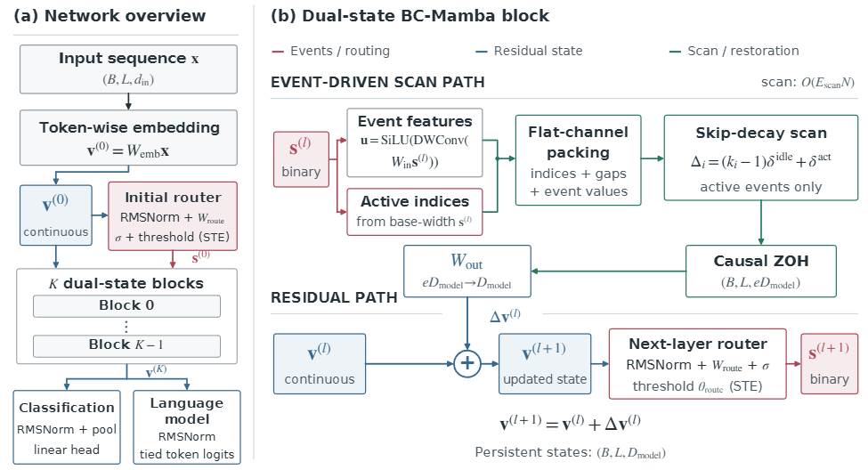

# BC_mamba

Chinese version: [README_zh.md](README_zh.md)

**Binary-Compressed Selective Scans for Training-Efficient Sequence Modeling**

BC_mamba is a research codebase for event-driven sequence modeling with sparse, binary-compressed selective scans.

*Architecture overview. The left panel shows the full sequence model; the right panel shows the event-driven scan and continuous-memory paths inside one block.*

### What the model does

BC_mamba separates two roles that are often combined in sequence models:

- **Binary spike state at layer l**: learned threshold routing selects active channel-position events and supplies the features used by the recurrent scan. A straight-through estimator supports training through the binary threshold.
- **Continuous memory state at layer l**: residual updates accumulate restored scan outputs across network depth and provide the representation used to generate the next layer's spikes.

Inside a block, active events are packed into flat channel streams. The selective state-space recurrence runs at those events only. The elapsed time across skipped positions is preserved through inter-spike decay, and a causal zero-order hold (ZOH) restores event outputs to a dense sequence before they update the continuous memory. The scan work therefore depends on the number of active events; projections and restoration still include dense operations.

### Scope and reported results

This code package contains the model implementation and training scripts for the five Long Range Arena (LRA) tasks: ListOps, Text, Retrieval, Image, and Pathfinder. The manuscript also reports Speech Commands (SC10) and WikiText-103 experiments, but those experiment pipelines are not included in this LRA code archive.

The manuscript reports an LRA average accuracy of **70.15%** for BC_mamba, compared with **70.17%** for the S6 reference. Across the five LRA tasks, it reports **35-60% lower per-epoch training time** and **27-52% lower peak GPU memory** than S6. It also reports **96.00% accuracy on SC10** and a **25.03 perplexity** for a 130M-parameter WikiText-103 model trained from scratch; the language-modeling result demonstrates feasibility, not superiority or training-efficiency gains at that scale. These are manuscript-reported measurements; runtime and memory depend on hardware and the experiment setup.

### Repository layout

- **[spike_mamba/](spike_mamba/)**: model and selective-scan interface
- **[csrc/selective_scan/](csrc/selective_scan/)**: selective-scan CUDA kernels
- **[csrc/r_nodecay/](csrc/r_nodecay/)**: recurrent output restoration kernels
- **[csrc/extract/](csrc/extract/)**: event extraction CUDA extension
- **[configs/lra.yaml](configs/lra.yaml)**: LRA configuration
- **[scripts/run_lra.sh](scripts/run_lra.sh)**: task runner
- **[train_lra.py](train_lra.py)**: Python training entry point

### Installation

The CUDA extensions require a CUDA-enabled PyTorch installation and a working CUDA compiler toolchain.

    pip install -r requirements.txt
    bash build_extensions.sh
    python tests/test_import.py

### LRA data

Set **DATA_ROOT** to a directory with the following layout. The cifar directory is optional and can be populated by torchvision.

    DATA_ROOT/
    ├── cifar/
    ├── imdb/
    ├── listops-1000/                  # or lra_release/listops-1000/
    └── lra_release/lra_release/
        ├── pathfinder32/
        └── tsv_data/                  # AAN retrieval data

The loaders also accept the fallback paths documented in [scripts/run_lra.sh](scripts/run_lra.sh).

### Run an LRA task

    bash scripts/run_lra.sh listops "$DATA_ROOT" 0
    bash scripts/run_lra.sh text "$DATA_ROOT" 0
    bash scripts/run_lra.sh retrieval "$DATA_ROOT" 0
    bash scripts/run_lra.sh image "$DATA_ROOT" 0
    bash scripts/run_lra.sh pathfinder "$DATA_ROOT" 0

The optional fourth argument sets the output directory and the fifth sets the random seed:

    bash scripts/run_lra.sh pathfinder "$DATA_ROOT" 0 outputs/lra_runs 42

For a custom configuration, use the Python entry point directly:

    python train_lra.py --task listops --data_dir /path/to/listops-1000

Run [train_lra.py](train_lra.py) --help to see all options. Training outputs are written under outputs/ and are ignored by Git.

### Manuscript

*BC-Mamba: Binary-Compressed Selective Scans for Training-Efficient Sequence Modeling.*

### License

The code is released under the [Apache License 2.0](LICENSE). Third-party copyright notices in derived Mamba selective-scan sources are retained.
