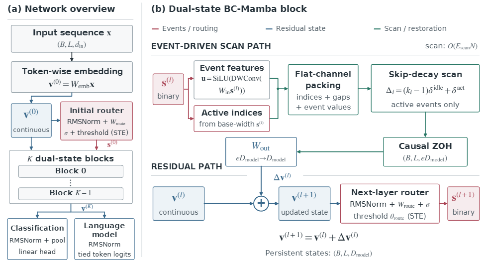

# BC_mamba

## 项目介绍

**BC_mamba：面向高效序列建模的二值压缩选择性扫描**

BC_mamba 是一个通过稀疏二值事件压缩选择性状态空间扫描来实现事件驱动序列建模的研究代码项目。

*架构图：左侧展示完整序列网络，右侧展示单个模块中的事件扫描路径和连续记忆路径。*

### 项目在做什么

BC_mamba 将序列建模中的两种状态分开处理：

- **第 l 层的二值脉冲状态**：通过可学习阈值选择需要计算的通道和序列位置，并提供扫描分支使用的特征。训练时使用直通估计器处理二值阈值的梯度。
- **第 l 层的连续记忆状态**：跨网络层累积恢复后的扫描输出，并用于生成下一层的脉冲。

每个模块先将活跃事件打包成通道序列，只在这些事件上执行选择性状态空间递归。被跳过位置经过的时间通过脉冲间隔衰减保留下来；随后使用因果零阶保持（ZOH）将事件输出恢复成稠密序列，再更新连续记忆。因此递归扫描的计算量随活跃事件数变化；投影和序列恢复中仍包含稠密计算。

### 代码范围与论文结果

当前代码包包含模型实现及长程序列基准（LRA）五项任务的训练脚本：ListOps、Text、Retrieval、Image 和 Pathfinder。论文还报告了 Speech Commands（SC10）和 WikiText-103 实验，但这些实验流程不包含在当前 LRA 代码包中。

论文报告 BC_mamba 在 LRA 上的平均准确率为 **70.15%**，S6 参考结果为 **70.17%**。在五项 LRA 任务中，论文报告每轮训练时间降低 **35-60%**，峰值 GPU 显存降低 **27-52%**。论文还报告 SC10 准确率为 **96.00%**；在 WikiText-103 上从头训练的 1.3 亿参数模型困惑度为 **25.03**，该结果用于说明模型具备规模可行性，不代表语言建模优势或该规模下的训练效率提升。这些数字来自论文中的实验测量；实际速度和显存占用会受到硬件与实验配置影响。

### 目录结构

- **spike_mamba/**：模型与选择性扫描接口
- **csrc/selective_scan/**：选择性扫描 CUDA 内核
- **csrc/r_nodecay/**：递归输出恢复内核
- **csrc/extract/**：事件提取 CUDA 扩展
- **configs/lra.yaml**：LRA 配置
- **scripts/run_lra.sh**：任务运行脚本
- **train_lra.py**：Python 训练入口

### 安装

CUDA 扩展需要安装支持 CUDA 的 PyTorch，并配置可用的 CUDA 编译工具链。

    pip install -r requirements.txt
    bash build_extensions.sh
    python tests/test_import.py

### LRA 数据目录

将 **DATA_ROOT** 设置为包含下列目录结构的数据路径。cifar 可选，缺少时可由 torchvision 下载或创建缓存。

    DATA_ROOT/
    ├── cifar/
    ├── imdb/
    ├── listops-1000/                  # 或 lra_release/listops-1000/
    └── lra_release/lra_release/
        ├── pathfinder32/
        └── tsv_data/                  # AAN 检索任务数据

数据加载器也支持 [scripts/run_lra.sh](scripts/run_lra.sh) 中说明的备用路径。

### 运行 LRA 任务

    bash scripts/run_lra.sh listops "$DATA_ROOT" 0
    bash scripts/run_lra.sh text "$DATA_ROOT" 0
    bash scripts/run_lra.sh retrieval "$DATA_ROOT" 0
    bash scripts/run_lra.sh image "$DATA_ROOT" 0
    bash scripts/run_lra.sh pathfinder "$DATA_ROOT" 0

可选的第 4 个参数指定输出目录，第 5 个参数指定随机种子。自定义配置可以直接调用 train_lra.py：

    bash scripts/run_lra.sh pathfinder "$DATA_ROOT" 0 outputs/lra_runs 42
    python train_lra.py --task listops --data_dir /path/to/listops-1000

使用 [train_lra.py](train_lra.py) --help 查看全部选项。训练输出写入 outputs/，并由 Git 忽略。

### 论文

论文：*《BC-Mamba：面向高效序列建模的二值压缩选择性扫描》*。

### 许可证

代码采用 [Apache License 2.0](LICENSE) 发布。派生自 Mamba selective-scan 的第三方版权声明已保留。
